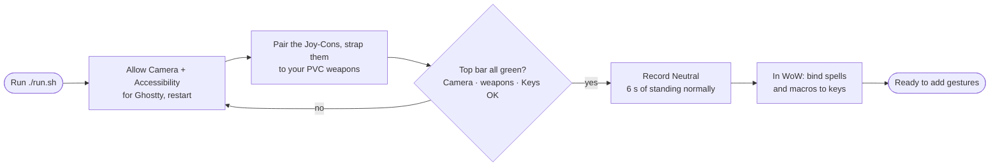
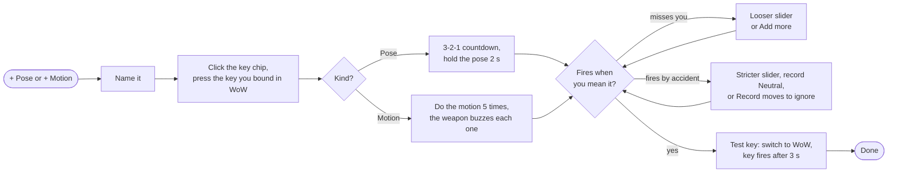
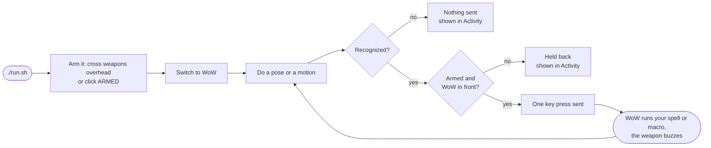
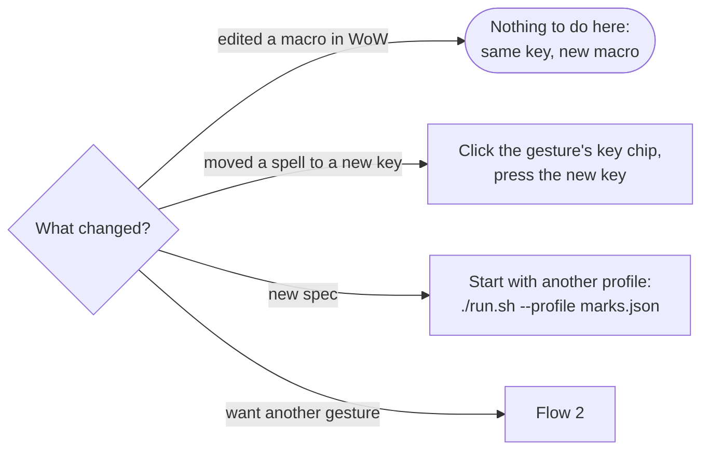
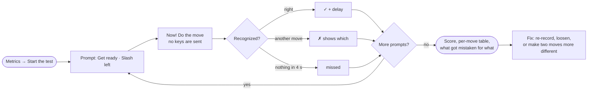
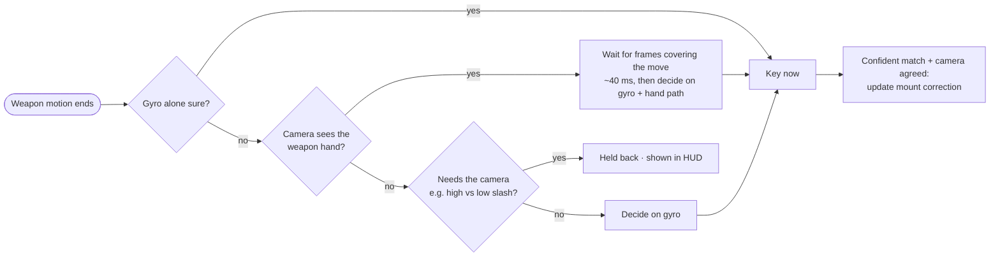
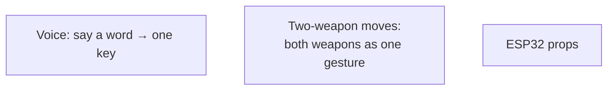

# User flows

The Joy-Cons are strapped to PVC weapons, so there are no controller buttons. Every input is a
body pose (webcam) or a weapon motion (Joy-Con).

## 1. First-time setup

## 2. Add a gesture

## 3. Playing

## 4. Changing things as you go

## 5. Checking accuracy

## 6. Camera + gyro during play

## Not built yet

Turning the camera stays on the mouse or the A / D keys (no bow-tilt steering).

