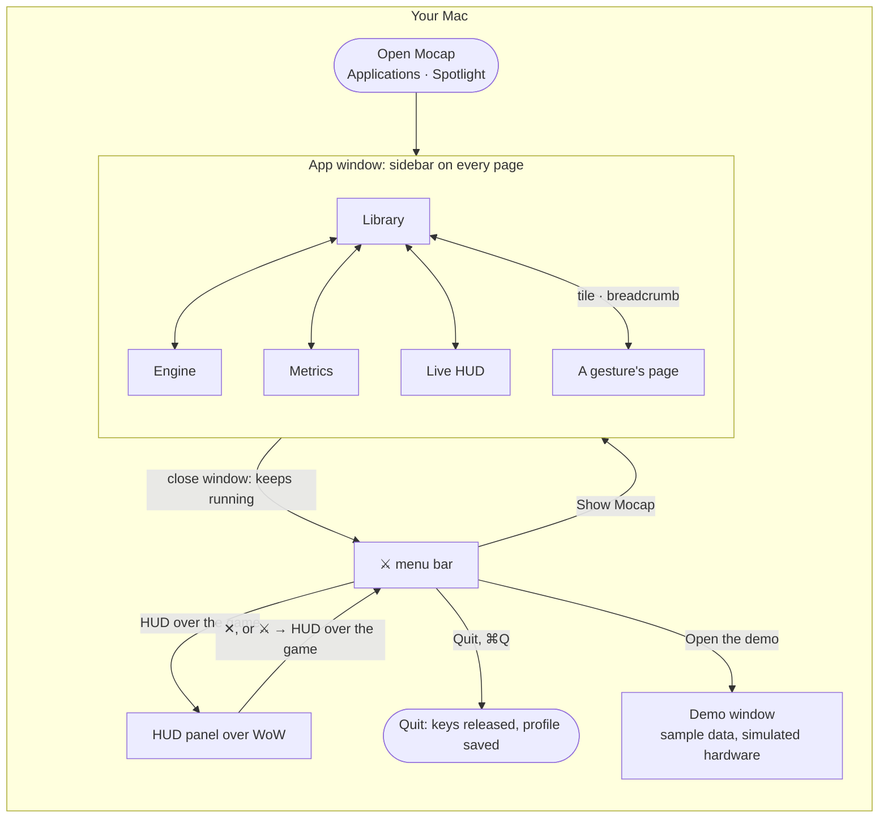
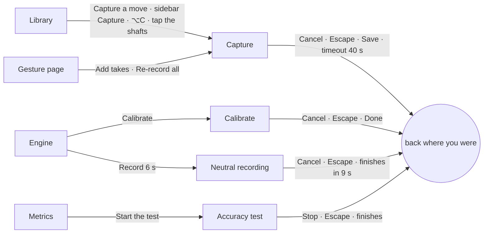
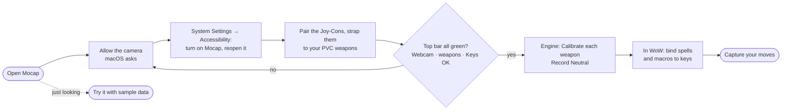
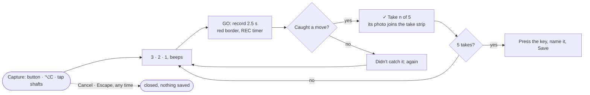
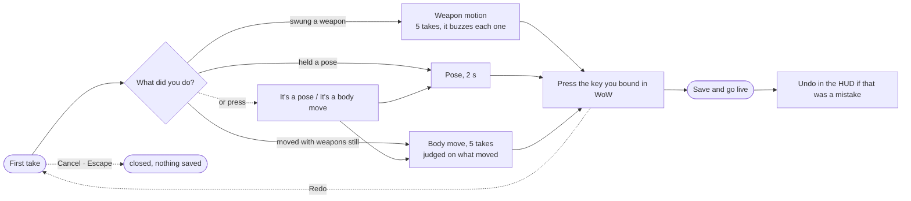
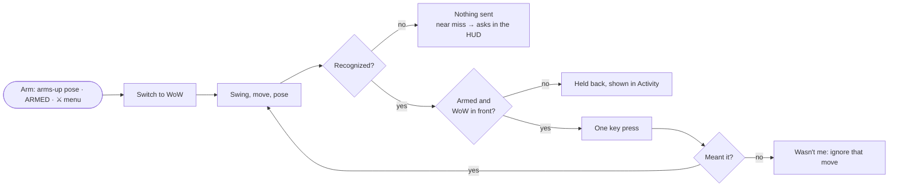
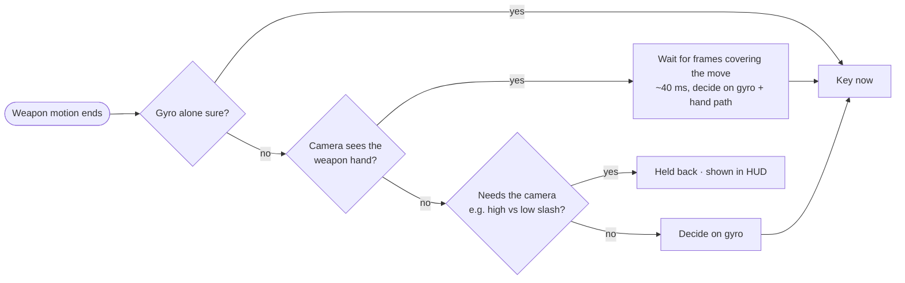
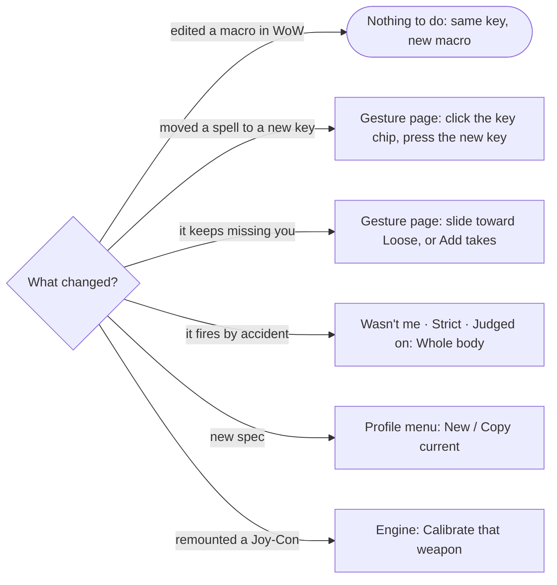
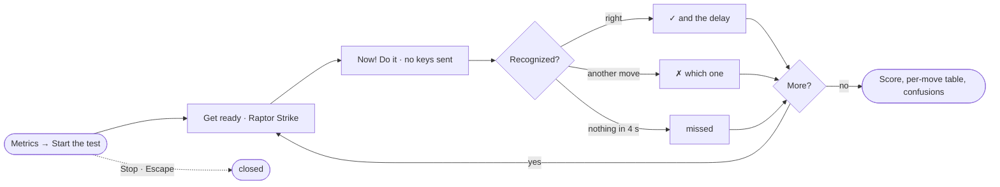

# User flows: every screen, how you get in, how you get out

The Joy-Cons are strapped to PVC weapons, so there are no controller buttons. Every input is a
body pose, a body move (webcam), or a weapon motion (Joy-Con). The app is a window, a ⚔ item in
the menu bar, and an optional HUD panel over the game.

**Rule: nothing traps you.** Every pop-up has a button out *and* Escape; every page is in the
sidebar; the HUD page has "← Back to the app". `lab/ui_flows_check.py` walks all of this in a
real browser with real mouse and key presses and checks the app agrees (see the end).

## The map

Pop-ups open on top of a page and always close back to it:

## Every screen

| Screen | Ways in | Ways out |
|---|---|---|
| App window | Open Mocap; ⚔ → Show Mocap; click the Dock icon | Close the window (keeps running in the menu bar); ⌘Q; ⚔ → Quit |
| Library | Sidebar; "← Back to the app" from the HUD; breadcrumb on a gesture page | Sidebar; a tile; Capture |
| Gesture page | A tile in the Library | "Library" breadcrumb; sidebar |
| Engine | Sidebar | Sidebar |
| Metrics | Sidebar; ⚔ → Accuracy test… | Sidebar |
| Live HUD (in the window) | Sidebar | "← Back to the app"; Escape; sidebar is not shown here |
| HUD panel over the game | ⚔ → HUD over the game; `--overlay` | Its ✕ button; ⚔ → HUD over the game again; ▴ collapses it |
| Capture (3-2-1 takes, live video + skeleton) | Capture a move; sidebar Capture; ⌥C; tap the shafts together; Add takes / Re-record all; + Pose; + Body move | Cancel; Escape; Save and go live; Redo (starts over); times out 40 s after your last kept take |
| Choosing a key (gesture page) | Click the key chip | Press a key; Escape; click anywhere else |
| Calibrate a weapon | Engine → a weapon → Calibrate | Cancel; Escape; Done on the summary |
| Neutral recording | Engine → Record 6 s | Cancel; Escape; finishes by itself |
| Accuracy test | Metrics → Start the test; ⚔ → Accuracy test… | Stop; Escape; finishes by itself |
| "Saved" message (HUD) | Saving a capture | ✕; Undo; fades after 12 s |
| Near-miss question (HUD) | A move almost fired | Yes, loosen it; No, ignore that move; Not now; fades after 20 s |
| "Wasn't me" (HUD) | Something fired | Press it (marks it wrong); fades after 15 s |
| Delete a gesture | Gesture page → Delete gesture | Click again to delete; wait 3 s and it backs off |
| Demo window | ⚔ → Open the demo; Library → Try it with sample data (empty Library) | Close it or ⌘Q (it's a separate app instance) |

Photos of your takes are files in the data folder; removing a take, clearing, deleting a gesture,
Undo, Cancel and Redo all delete the photos nothing uses any more (a copied profile keeps the ones
it shares).

## 1. First-time setup

## 2. Capture a move

Like recording software: you see yourself on the webcam with your skeleton on top, each take is
a countdown and a short recording, and each kept take's photo (its peak, skeleton on top) lands
in the take strip under the video. The gesture keeps those photos: its tile plays your most
typical take on hover and its page shows every take.

What it decides from the first take (or press "It's a pose" / "It's a body move"):

## 3. Playing

## 4. Camera + gyro during play

## 5. Changing things as you go

## 6. Checking accuracy

## How this was checked

`lab/ui_flows_check.py` drives the real UI in Chrome against the app with simulated hardware
(and against the demo, with its 18 sample gestures), pressing and releasing the mouse and keys
like a person, and checks the engine's state after each step: every page from the sidebar and
back; every gesture's tile to its page and back; the Library filters; changing "Judged on" and
back; capture opened three ways and left by Cancel, Escape, It's a pose, It's a body move; a body
move captured through the key step, Redo, Escape, then saved with a real key press; the key
step's Cancel; the HUD's ✕; a gesture's key chip and Escape; Delete backing off by itself;
Calibrate, Neutral and the accuracy test each left by their button and by Escape; every photo
on the tiles and gesture pages loads; the key step shows the takes' photos; and no JavaScript
errors anywhere.

Walking it found and fixed:
1. **Cancel didn't work** (nor any button, sometimes): the page redrew 20 times a second during
   capture and a press-and-release across a redraw was lost. Pages now redraw only when what
   they show changes, and buttons and links act on press-and-release even across a redraw.
2. The Live HUD page had no way back in the app window (no browser back button there).
3. A Neutral recording couldn't be cancelled; the near-miss question had no "Not now"; the
   "Saved" message and the HUD panel had no ✕.
4. Escape only worked in some pop-ups; it now closes any of them.
5. In the demo, a move still playing when you opened a capture landed in it.
